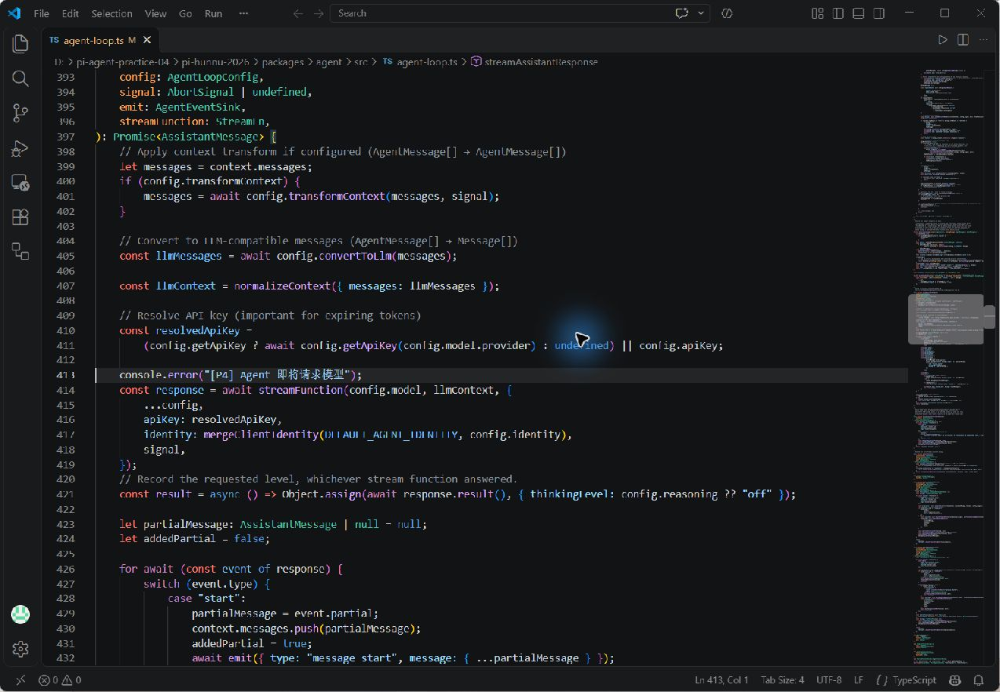
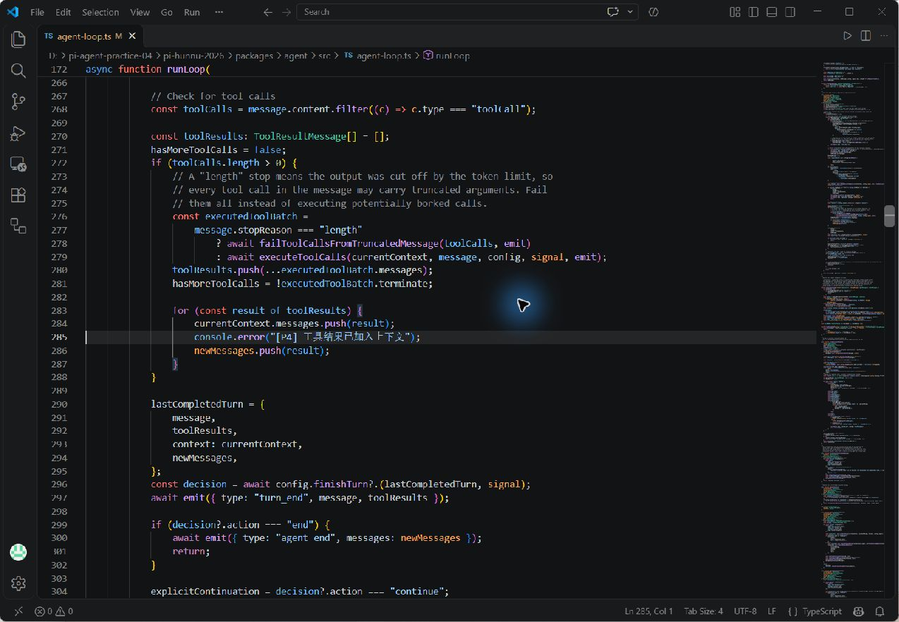
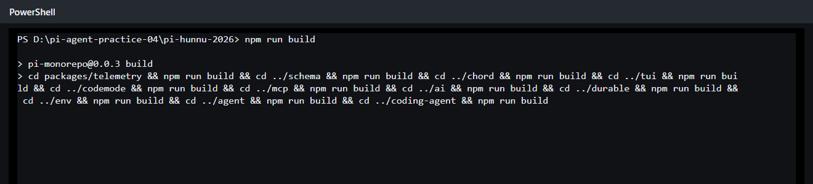
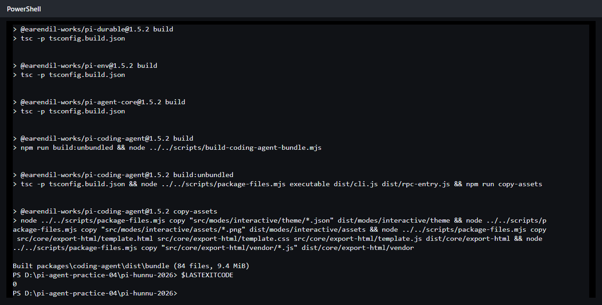
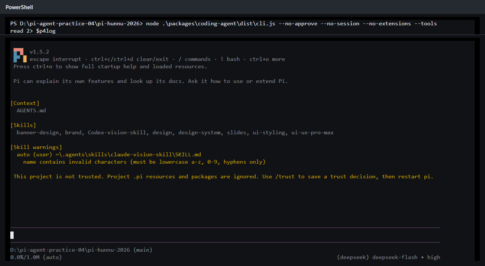
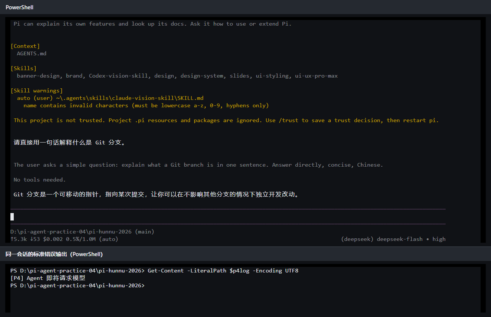
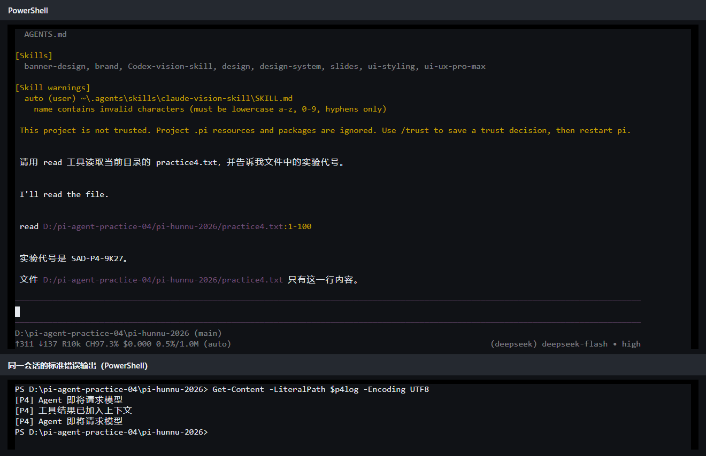
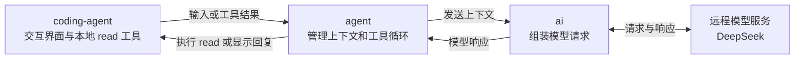

# 实践课 4　Pi Agent 的模型调用与运行流程

实验使用实践课 3 的小组源码，版本为 `c3cc916`。[小组仓库](https://github.com/SAD-OpenStudy/pi-hunnu-2026)

## 任务一　添加两行日志

**S1** 在 `packages/agent/src/agent-loop.ts` 第 413 行、`await streamFunction(...)` 上方打印 `[P4] Agent 即将请求模型`。



**S2** 在同一文件第 285 行、`for` 循环的 `currentContext.messages.push(result)` 后打印 `[P4] 工具结果已加入上下文`。



## 任务二　编译并启动

**S3a、S3b** 在项目根目录执行 `npm run build`。编译成功并返回 PowerShell 提示符，随后查看 `$LASTEXITCODE`，结果为 `0`。





**S4** 使用 `node .\packages\coding-agent\dist\cli.js` 启动编译产物，进入 Pi 的交互界面。



## 任务三　对比两次会话

在项目根目录创建 `practice4.txt`，写入一行 `SAD-P4-9K27`。两次都新开会话并使用 `deepseek-flash`，各会话的标准错误日志显示在截图下栏。

### S5　会话 A（直接问答）

- 输入「请直接用一句话解释什么是 Git 分支。」
- 工具调用 0 次，进入 1 轮模型调用。
- 最终回复「Git 分支是一个可移动的指针，指向某次提交，让你可以在不影响其他分支的情况下独立开发改动。」

```text
[P4] Agent 即将请求模型
```



### S6　会话 B（读取文件）

- 输入「请用 read 工具读取当前目录的 practice4.txt，并告诉我文件中的实验代号。」
- `read` 调用 1 次，进入 2 轮模型调用。
- 最终回复「实验代号是 SAD-P4-9K27。文件 `D:/pi-agent-practice-04/pi-hunnu-2026/practice4.txt` 只有这一行内容。」

```text
[P4] Agent 即将请求模型
[P4] 工具结果已加入上下文
[P4] Agent 即将请求模型
```



会话 B 的第一轮模型响应给出了 `read` 调用，由 `coding-agent` 的本地 `read` 工具读取文件。`agent` 将包含实验代号的工具结果写入上下文，下一轮请求随原有对话带上上一轮的 `read` 调用和对应的 `toolResult`，模型据此给出代号。


